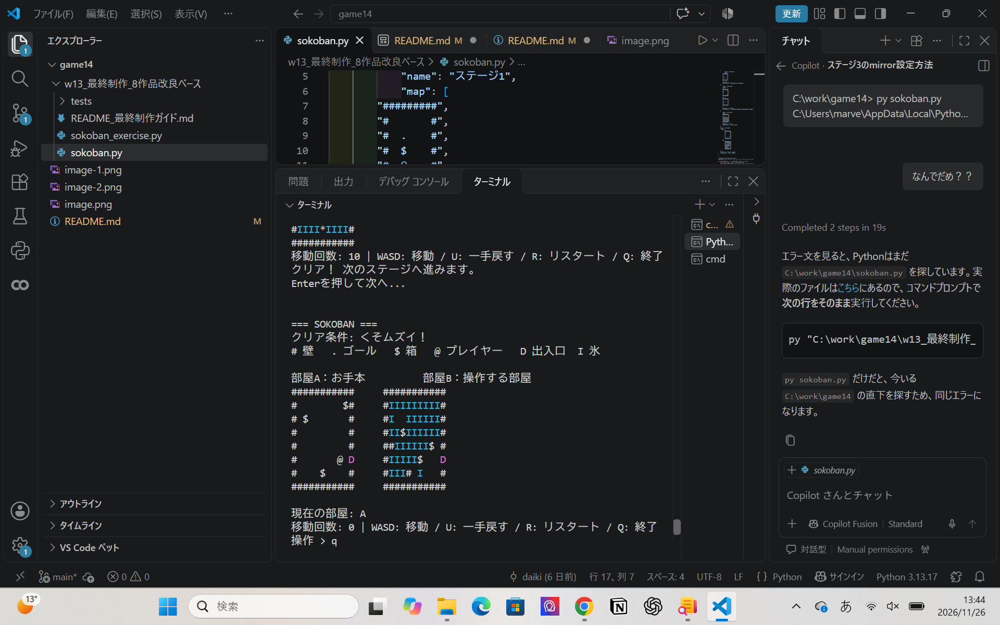

# ゲームタイトル

倉庫番Z

## ゲームの概要

箱を動かして目的の場所へと動かすゲーム。

## 動作環境

- OS： Windows
- Python： 3.13.17 で動作確認済み
- 必要なライブラリ： 追加ライブラリ不要

## インストール方法

- 追加ライブラリのインストールは不要なのでゲームのファイルをダウンロードし、展開してください。

## 起動方法

- py "C:\work\game14\w13_最終制作_8作品改良ベース\sokoban.py"
もしくは
- python "C:\work\game14\w13_最終制作_8作品改良ベース\sokoban.py"

## 操作方法

W
上に移動

A
左に移動

S
下に移動

D
右に移動

U
一手戻す

R
ステージを最初からやり直す

Q
ゲームを終了する

※ 操作キーを入力した後、Enterキーを押して確定します。

##　マップの記号

#
壁

@
プレイヤー

$
箱

.
ゴール

*
ゴール上の箱

+
ゴール上のプレイヤー

D
部屋を移動する出入口

I
滑る氷の床

## 追加・改良した機能

### 改良機能01：mirror機能

部屋Aと部屋Bの2つのマップを使用する、新しいゲームルールを追加しました。

部屋Aはお手本となる部屋で、箱を押すことができません。部屋Bでは箱を自由に押すことができ、部屋Aと箱の座標が完全に一致するとステージクリアになります。

また、出入口 D にプレイヤーが移動すると、現在操作している部屋を自動的に切り替えられるようにしました。

主に parse_map()、load_level()、move_player()、is_cleared() を変更しました。

### 改良機能02：Ice機能

氷の床に入ると、プレイヤーや箱が進行方向へ滑る機能を追加しました。

マップ上の I を氷の床として扱い、parse_map() で氷の座標を保存するようにしました。

移動処理では while 文を使用し、氷の上にいる間は同じ方向への移動を繰り返します。氷のない床に出た場合や、壁や箱などの障害物がある場合は停止します。

これにより、箱をどの方向へ押すかだけでなく、どこで停止させるかも考える必要があるパズルを作成しました。

主に parse_map()、make_row()、move_player() を変更しました。

### 改良機能03：2画面同時表示機能

Mirrorステージで、部屋Aと部屋Bを同時に表示する機能を追加しました。

マップの1行を文字列として生成する make_row() 関数を作成し、draw_game() で2つの部屋の各行を横に並べるようにしました。

プレイヤーは現在操作している部屋にのみ表示されます。

これにより、部屋Aの箱の位置を覚える必要がなくなり、2つの部屋を比較しながらゲームを進められるようになりました。

<!-- 実装・動作確認が完了した機能だけを記載してください。
未実装の機能の見出しは削除し、「既知の問題・制限事項」に記載してください。
4つ以上の機能を改良した場合は見出しを追加してください。
-->

## スクリーンショット

## 既知の問題・制限事項

「現時点で確認されている問題なし」

## クレジット

- ベースとなったゲーム　倉庫番
- 開発言語　python
-  使用した外部素材・ライブラリ　なし

<!-- 提出前の確認（このコメントは削除しても構いません）
- 括弧内の説明や記入例を自分の作品の情報に書き換えたか
- READMEの手順でゲームを起動できるか
- 実装済みの機能と未実装の機能を区別しているか
- 個人情報、パスワード、APIキーなどを含んでいないか
- 公開するコードや素材の利用条件を確認したか
- GitHub上でREADMEと画像が正しく表示されているか
-->
